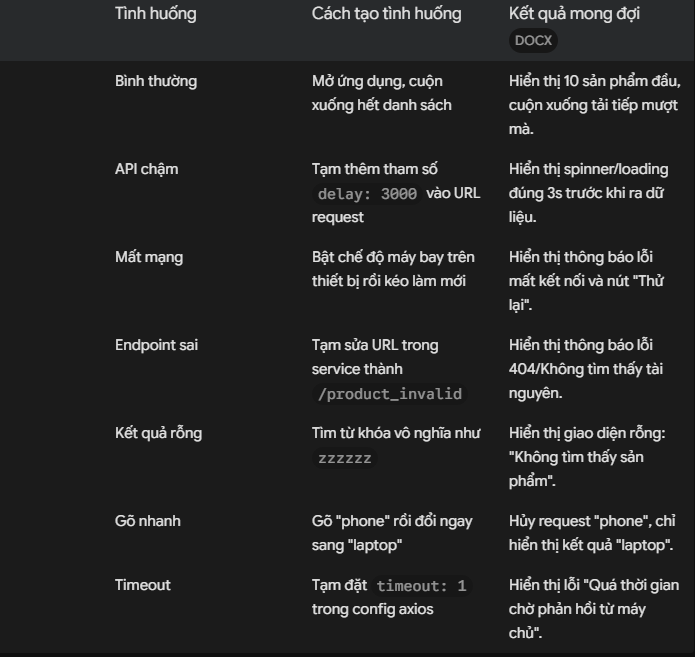

# Đặc tả kỹ thuật và Yêu cầu Chức năng (SPEC.md)

## 1. Mục tiêu người dùng

- Người dùng có thể xem danh sách sản phẩm cửa hàng với hình ảnh, tên và giá bán.
- Người dùng có thể cuộn xuống để tải thêm sản phẩm mượt mà (phân trang).
- Người dùng có thể tìm kiếm sản phẩm theo từ khóa nhanh chóng.
- Người dùng nhận được phản hồi rõ ràng ở mọi trạng thái hệ thống (đang tải, lỗi mạng, rỗng dữ liệu).

---

## 2. Hợp đồng API (API Contract)

### 2.1. Danh sách sản phẩm

- **Phương thức:** `GET`
- **Đường dẫn:** `/products`
- **Tham số:**
  - `limit` (number): Số lượng sản phẩm trả về mỗi trang (Mặc định bài lab: 10).
  - `skip` (number): Số sản phẩm bỏ qua (`(trang - 1) * limit`).
- **Phản hồi thành công (200 OK):**
  - `products` (Array): Danh sách các đối tượng sản phẩm.
  - `total` (number): Tổng số sản phẩm có trên hệ thống.
  - `skip` (number): Số sản phẩm đã bỏ qua.
  - `limit` (number): Giới hạn lấy trong request.

### 2.2. Tìm kiếm sản phẩm

- **Phương thức:** `GET`
- **Đường dẫn:** `/products/search`
- **Tham số:**
  - `q` (string): Từ khóa tìm kiếm.
  - `limit` (number): Số lượng kết quả mỗi trang.
  - `skip` (number): Số kết quả bỏ qua.
- **Phản hồi thành công (200 OK):** Cấu trúc tương tự danh sách sản phẩm.

### 2.3. Cấu trúc một sản phẩm (Product item)

- Các trường bắt buộc hiển thị trên màn hình: `id`, `title`, `price`, `thumbnail`.

---

## 3. Các trạng thái giao diện (UI States)

1. **Đang tải (Loading):** Hiển thị vòng quay (`ActivityIndicator`) ở giữa màn hình khi tải lần đầu, hoặc ở cuối danh sách khi tải trang tiếp theo.
2. **Có dữ liệu (Data):** Hiển thị danh sách sản phẩm dạng `FlatList` gồm ảnh nhỏ (`thumbnail`), tên sản phẩm (`title`) và giá (`price`).
3. **Rỗng (Empty):** Hiển thị thông báo "Không tìm thấy sản phẩm" khi kết quả trả về từ API có `products: []`.
4. **Lỗi (Error):** Hiển thị thông báo lỗi thân thiện (ví dụ: "Không thể kết nối máy chủ", "Quá thời gian chờ") kèm nút **"Thử lại"**.

---

## 4. Tiêu chí chấp nhận (Acceptance Criteria)

- **AC1 (Trạng thái đang tải):**
  - _Cho_ ứng dụng đang gửi yêu cầu lấy danh sách sản phẩm,
  - _Khi_ API chưa phản hồi,
  - _Thì_ hiển thị vòng quay tải dữ liệu và không hiển thị danh sách rỗng hay dữ liệu cũ.
  - _Cách kiểm chứng:_ Tạm thêm `delay: 3000` vào request và quan sát giao diện.

- **AC2 (Phân trang tự động):**
  - _Cho_ người dùng cuộn danh sách đến gần cuối màn hình,
  - _Khi_ số sản phẩm đã tải nhỏ hơn `total` (`skip + limit < total`),
  - _Thì_ ứng dụng tự động gọi API lấy 10 sản phẩm tiếp theo và nối vào danh sách hiện tại.
  - _Cách kiểm chứng:_ Cuộn danh sách trên Expo Go / Web và xem log số lượng item tăng lên.

- **AC3 (Dừng tải khi hết dữ liệu):**
  - _Cho_ ứng dụng đã tải tới trang cuối cùng (`skip + limit >= total`),
  - _Khi_ người dùng tiếp tục cuộn xuống cuối,
  - _Thì_ ứng dụng không gửi thêm bất kỳ request API nào nữa.
  - _Cách kiểm chứng:_ Kiểm tra tab Network/Console log không phát sinh request mới.

- **AC4 (Tìm kiếm có Debounce):**
  - _Cho_ người dùng nhập từ khóa vào ô tìm kiếm,
  - _Khi_ người dùng ngừng gõ đủ `500ms`,
  - _Thì_ ứng dụng mới bắt đầu gửi request tìm kiếm đến API.
  - _Cách kiểm chứng:_ Gõ liên tục chuỗi "laptop" và kiểm tra API chỉ gọi 1 lần duy nhất sau khi dừng gõ.

- **AC5 (Hủy yêu cầu tìm kiếm cũ - AbortController):**
  - _Cho_ một request tìm kiếm cũ đang chờ phản hồi,
  - _Khi_ người dùng thay đổi từ khóa tìm kiếm mới,
  - _Thì_ request cũ bị hủy bỏ lập tức để tránh kết quả cũ ghi đè lên kết quả mới.
  - _Cách kiểm chứng:_ Giả lập mạng chậm, gõ từ "phone" rồi gõ nhanh sang "laptop", kiểm tra request "phone" bị cancel.

- **AC6 (Xử lý lỗi mạng & Thử lại):**
  - _Cho_ thiết bị mất kết nối mạng hoặc server bị lỗi,
  - _Khi_ gọi API thất bại,
  - _Thì_ hiển thị thông báo lỗi rõ ràng và cung cấp nút "Thử lại" để người dùng thực hiện lại request.
  - _Cách kiểm chứng:_ Bật Chế độ máy bay (Airplane Mode) trên điện thoại và thực hiện kéo để làm mới (Pull-to-refresh).

- **AC7 (Trạng thái rỗng):**
  - _Cho_ người dùng tìm kiếm một từ khóa không tồn tại (ví dụ: `zzzzzz`),
  - _Khi_ API trả về danh sách `products` rỗng,
  - _Thì_ hiển thị màn hình thông báo "Không tìm thấy sản phẩm phù hợp".
  - _Cách kiểm chứng:_ Nhập `zzzzzz` vào ô tìm kiếm và kiểm tra giao diện.

---

## 5. Ràng buộc kỹ thuật (Technical Constraints)

- Mọi lời gọi API bắt buộc nằm trong thư mục `src/api/`. Màn hình không gọi `axios` trực tiếp (Theo `AGENTS.md`).
- Lấy địa chỉ API từ biến môi trường `EXPO_PUBLIC_API_URL`.
- Không hardcode token, khóa API hay mật khẩu trong mã nguồn.

## 6. Kế hoạch kiểm thử (Test Plan & Test Cases)

